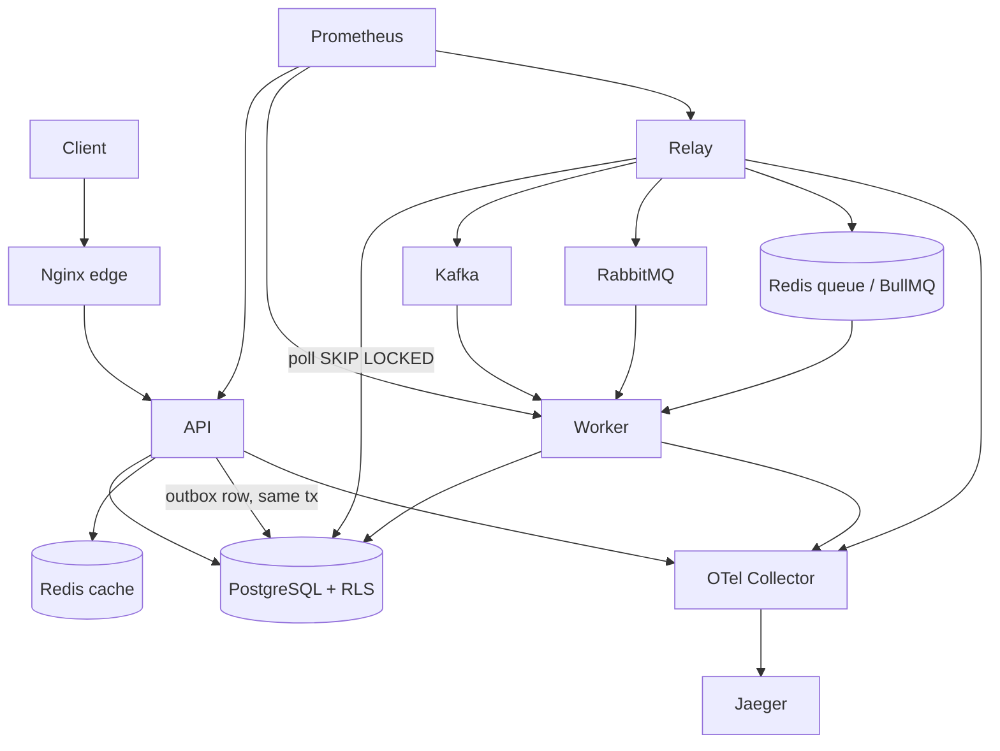

# Architecture (Phase 1, approved)

Decisions: modular monolith with `api`/`worker`/`relay` processes; TypeORM + hand-written
SQL migrations; shared schema + `tenant_id` + RLS (transaction-local `set_config`);
UUIDv7 ids; Kafka = facts, RabbitMQ = commands, BullMQ = scheduled/delayed jobs;
transactional outbox; durable idempotency in Postgres; two Redis instances.
Full rationale: Phase 1 review in the project chat.
